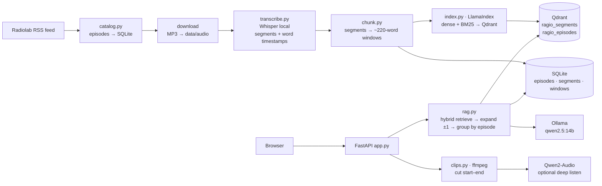

# Ragio-Lab — Architecture & Design

*A local AI engine stack with every Radiolab episode as its retrieval corpus.*
Status: v0.1 design + starter repo (`ragio-lab-starter.zip`) — September 15, 2026

---

## 1. Goal

Make the entire Radiolab archive (~700+ episodes, ~500–600 hours of audio) available as **grounded context** for a local LLM, so that any question — analytical ("how has the show treated free will over 20 years?"), review ("summarize the episode on CRISPR and list who was interviewed"), or creative ("write a lesson plan that threads three episodes on memory") — is answered with **citations down to the second** and the ability to **hear the clip**.

Non-goals for v0.1: speaker diarization, multi-user auth, cloud deployment, redistributing audio.

## 2. Stack (your four-part framework, made concrete)

| Layer | Component | Role |
|---|---|---|
| Audio ingestion | **Whisper**, local — `faster-whisper` (CTranslate2) on Linux/NVIDIA/CPU, `mlx-whisper` on Apple Silicon | MP3 → segments with start/end + word timestamps; VAD filter to skip music beds |
| Database & RAG | **Qdrant** (Docker, on disk) + **LlamaIndex**; **SQLite** as catalog/docstore | Qdrant holds vectors + light payload; SQLite holds pipeline state and the full text of every segment/window (the "parent" side of parent → child) |
| Brain | **Ollama** serving `qwen2.5:14b` (text) and `nomic-embed-text` (embeddings); **Qwen2-Audio-7B-Instruct** as an optional audio tool | Text model answers with citations; audio model "listens" to a retrieved clip when the question is about sound, not words |
| Web wrapper | **FastAPI**, single `app.py` + one static HTML page | JSON + Server-Sent Events streaming, clip serving, transcript browsing |

### Two corrections to the brief, made in the design

1. **Ollama doesn't run audio-input models** (it serves text and vision), and the model usually referred to as "Qwen2.5-Audio" ships as *Qwen2-Audio-7B-Instruct* (Qwen2.5-Omni is the newer any-to-any successor). So the brain is a text LLM in Ollama, and the audio model is a *tool* the app calls with a short clip — via a vLLM OpenAI-compatible endpoint on a GPU box, or `transformers` in-process on the Mac. This is also the cheaper architecture: you don't push an hour of audio through a 7B multimodal model per question; text retrieval finds the 90 seconds that matter first.
2. **Llama-3.2-Vision adds nothing to a radio archive.** Kept out of the critical path; it could later caption episode art or show-notes images.

## 3. Architecture



Everything runs on one machine; the only network calls are the RSS feed and MP3 downloads.

## 4. Data model — parent → child (Episode → Timestamps)

```
episode  id, guid, title, published, description, page_url, audio_url, duration_sec,
         audio_path, status, error, summary
  └── window[idx]   start, end, text        ← embedded child node (~220 words, ≤120 s, 1-segment overlap)
        └── segment[idx] start, end, text   ← raw Whisper segment (2–10 s); word timings in transcript JSON
```

- **Qdrant point id** = `uuid5(episode_id:idx)` → re-indexing upserts, never duplicates.
- **Qdrant payload** = `episode_id, idx, title, published, start, end, page_url` — enough to jump to the moment without a second lookup; the embedded text is prefixed with `Radiolab — <title> (<date>)` so the title contributes to the vector.
- **Parent context** is *not* stored as a giant node. A hit expands to its ±N neighbors from SQLite at query time, and overlapping expansions inside one episode merge into a single passage. This gives the "auto-merging" effect with one table and no docstore ceremony.
- **Second collection, `ragio_episodes`**: one node per episode holding an LLM-written summary + themes + people. Answers the "which episodes are about X?" class of question that segment-level retrieval handles poorly. Built after the first index pass (`index --summaries`).
- **Pipeline state** is a status column per episode: `catalogued → downloaded → transcribed → chunked → indexed` (or `failed` with the error). Every stage is idempotent and resumable; transcripts are cached as JSON on disk.

Why not LlamaIndex's `HierarchicalNodeParser` + `AutoMergingRetriever`? It works, but it needs a persisted docstore alongside Qdrant and hides the timestamp logic. The explicit table is easier to inspect, debug, and evolve (e.g., adding speaker labels later is one column).

## 5. Query flow

1. **Hybrid retrieval** — dense (`nomic-embed-text`) + BM25 sparse (fastembed) in one Qdrant query, fused server-side. Hybrid matters here: proper nouns (guest names, "HeLa", "Krulwich") are exactly where dense-only search fails.
2. **Neighbor expansion** — ±1 window from SQLite; merge overlaps.
3. **Group by episode**, rank episodes by best passage score.
4. **Prompt** — evidence blocks labelled `[E3] Title (2019-04-12) @ 12:04–14:31`; the system prompt requires inline labels and forbids answering beyond the evidence.
5. **Generate** — Ollama; streamed to the UI as SSE (sources arrive first so the UI renders players before the first token).
6. **Sources** — each carries `clip_url → /api/clip?ep&start&end` (ffmpeg cut, cached, ±0.5 s pad) and the episode page URL.

Optional step 7, **deep listen**: `POST /api/listen {episode_id, start, end, prompt}` cuts a WAV and asks the audio model. Use it for "what's the music under this segment?", "does the guest sound nervous?", "what does the archival tape sound like?".

## 6. API (FastAPI, `app.py`)

| Method | Path | Purpose |
|---|---|---|
| GET | `/` | UI |
| GET | `/api/episodes` | catalog + pipeline status |
| GET | `/api/episodes/{id}` | episode + windows (a readable, timestamped transcript) |
| GET | `/api/search?q=` | retrieval only, grouped by episode |
| POST | `/api/ask` | answer + sources (JSON) |
| POST | `/api/ask/stream` | same, SSE: `sources` → `token`… → `done` |
| GET | `/api/clip?ep&start&end` | MP3 clip (≤10 min) |
| POST | `/api/listen` | audio-native answer about a clip (≤3 min) |

## 7. Compute plan

| Backend | Hardware | Speed | Whole archive |
|---|---|---|---|
| `mlx-whisper` large-v3 | Apple Silicon | ~8–15× realtime | ~40–70 h (run overnight, resumable) |
| `faster-whisper` large-v3 fp16 | RTX 3090/4090 | ~30–50× | ~12–20 h |
| `faster-whisper` medium.en int8 | CPU | ~1–2× | weeks |

Embedding ~700 episodes × ~35 windows ≈ 25k nodes with `nomic-embed-text` is under an hour on a Mac. Episode summaries with a 14B model: ~1–2 min each ⇒ ~15–20 h; run it after the segment index is already useful.

Storage: audio ~30 GB; transcripts ~1 GB (with word timestamps); Qdrant ~ 200 MB.

## 8. Phased plan

| Phase | Deliverable | Done when |
|---|---|---|
| 0 | `make pipeline` on 3 episodes; ask one question with correct citations | you can click play on a cited clip and hear the quoted line |
| 1 | Full archive transcribed + indexed | `ragio status` shows all episodes `indexed`; eval hit@5 ≥ 0.85 on 25 golden questions |
| 2 | Episode summary index; "which episodes…" routing (query the parent collection first when the question is about episodes rather than facts) | cross-episode questions list the right episodes |
| 3 | Deep-listen tool wired to a GPU box or MPS | tone/music questions answered from audio |
| 4 | Creative propagation modes (§9); knowledge graph of people/themes across episodes | a themed reading list or lesson plan cites ≥3 episodes correctly |
| 5 | Diarization (WhisperX/pyannote) → speaker column; per-host/guest queries | "what has Latif said about…" works |

## 9. Creative knowledge propagation — what the engine enables

Each of these is a prompt template over the same retrieval layer, exposed as a mode in the UI:

- **Thread** — given a theme, retrieve across episodes and write a narrative connecting how the show's treatment evolved over the years, citing moments.
- **Curriculum** — build a lesson plan / reading list around a topic with timestamped listening assignments.
- **Debate map** — extract the competing positions across episodes on a contested question and who voiced them.
- **Timeline** — chronological view of every mention of an entity (person, idea, experiment).
- **Companion** — for one episode: summary, glossary, questions for discussion, related episodes (from the summary index).
- **Sound study** (deep listen) — how music and sound design are used at a chosen moment.

Guardrail: generation always shows its sources; creative modes remix *understanding*, they never reproduce transcript text at length.

## 10. Evaluation

`eval/questions.jsonl` holds questions with expected episode ids; `python -m ragio eval` prints hit@1/3/5. Tune in this order: hybrid on/off → window size (150/220/300 words) → top-k/neighbors → embedding model (`nomic-embed-text` vs `bge-m3` vs `mxbai-embed-large`). Add LlamaIndex faithfulness/relevancy evaluators once retrieval is stable — retrieval quality dominates answer quality in this domain.

## 11. Risks & mitigations

| Risk | Mitigation |
|---|---|
| Whisper hallucination on music/silence ("Thanks for watching") | VAD filter on; `condition_on_previous_text=False`; drop windows with < 20 words |
| Proper-noun misspellings in transcripts | hybrid BM25 helps partially; Phase 2: build an alias list from episode descriptions and inject as Whisper `initial_prompt` |
| Feed only exposes recent episodes | check `catalog` count vs radiolab.org; supplement with archived feed snapshots if needed |
| Ollama context overflow with many passages | prompt builder caps evidence at 24k chars; `RAGIO_LLM_CONTEXT=16384` set explicitly |
| Copyright | personal research use only; nothing redistributed; clips served locally |

## 12. Decisions log

- SQLite as docstore + status tracker (not a JSON manifest, not LlamaIndex's docstore): queryable, transactional, one file.
- Ollama for embeddings *and* LLM: one runtime to manage on the Mac; swap `RAGIO_EMBED_MODEL` if eval says so.
- Hybrid search from day one: the corpus is name-heavy.
- Audio model as a tool, not the brain: cost and Ollama compatibility.
- Env-var configuration, no config framework: single-file spirit of the brief.
